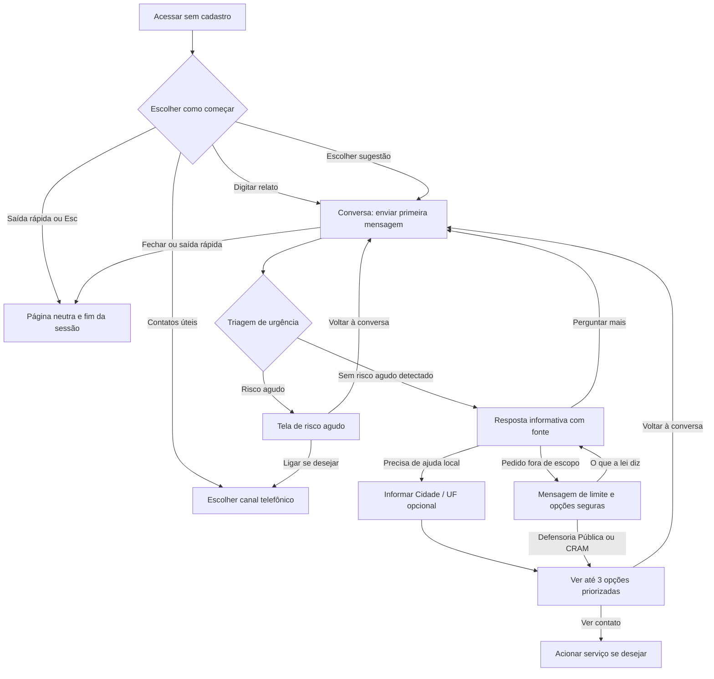

# Jornada do Usuário — Aurora

**Status:** aprovada pela usuária; revisões de produto e domínio ainda pendentes
**Perfil priorizado:** mulher em situação de violência psicológica ou que
procura informação e apoio para compreender o que está vivendo
**Tipo de documento:** usabilidade e requisitos funcionais; não define
implementação técnica nem especificação visual

> **Atenção:** este documento organiza os comportamentos definidos e os
> comportamentos propostos. Tudo que estiver marcado como **SUGESTÃO — validar**
> ainda não é requisito aprovado. A jornada não deve ser tratada como validada
> para uso real até revisão das pessoas especialistas de domínio pertinentes.
> A usuária aprovou a jornada em revisão anterior; decisões adicionais do J-00
> estão registradas no [plano de implementação](./plano-implementacao-jornada-usuario.md).

## 1. Objetivo e escopo

Descrever por onde a usuária começa, quais ações pode fazer sem depender de
outras etapas, como percorre a conversa e os caminhos de emergência,
informação e encaminhamento, e o que acontece quando retorna, pausa ou encerra
o uso.

O documento foca a usuária final. Ações administrativas não fazem parte desta
jornada. Cadastro, diário, módulos e plano de segurança são registrados como
fluxos futuros porque aparecem no backlog, mas não estão detalhados como telas
completas nas especificações consultadas.

O Aurora é uma ferramenta de psicoeducação e informação. Não realiza
diagnóstico, psicoterapia, aconselhamento jurídico individualizado nem decide
ou age pela usuária. A escolha de procurar um serviço é sempre da própria
usuária.

### Legenda de origem

- **[REQUISITO]** — comportamento descrito em `requisitos-aurora.md` ou no
  backlog.
- **[WIREFRAME]** — rótulo, texto ou interação mostrada em
  `Aurora — Wireframe.html`.
- **[IMPLEMENTADO]** — comportamento observado nas features atuais do frontend.
- **[GAP]** — decisão necessária que as fontes não definem.
- **[SUGESTÃO — validar]** — proposta para preencher um gap; precisa de
  aprovação antes de ser considerada requisito.

## 2. Princípios que orientam todas as telas

1. **Segurança primeiro.** Acesso a emergência e Saída Rápida não devem
   depender de cadastro ou conclusão de outra etapa.
2. **Acesso anônimo.** A usuária deve poder iniciar sem fornecer nome,
   telefone, e-mail ou outro identificador.
3. **Autonomia.** Apresentar informação e opções sem instruir a usuária a
   denunciar, sair de casa ou tomar uma decisão específica.
4. **Linguagem simples e não julgadora.** A usuária não precisa conhecer
   termos técnicos nem usar uma descrição “correta”.
5. **Transparência sobre sessão.** No modo anônimo, a conversa é temporária e
   não pode ser retomada depois que a sessão for encerrada.
6. **Sem falsa promessa de segurança digital.** A aplicação pode descartar o
   conteúdo que mantém na sessão, mas não controla histórico, monitoramento ou
   registros mantidos pelo navegador, dispositivo, rede ou terceiros.
7. **Uma ação principal por etapa.** Manter as escolhas curtas e claras. A
   recomendação do wireframe indica áreas de toque de pelo menos 44 px e
   contraste mínimo de 4,5:1; o desenho visual detalhado continua sendo
   referência do próprio wireframe.

## 3. Ações independentes, priorizadas

Estas são ações que a usuária deve conseguir iniciar sem completar relato,
triagem ou cadastro. A ordem prioriza segurança.

| Prioridade | Ação independente | Onde começa | Ação da usuária | Resultado esperado | Origem |
|---|---|---|---|---|---|
| P0 | Sair rapidamente | Qualquer tela | Acionar **Sair**/**Saída rápida (Esc)** ou pressionar Esc | Descartar o estado de conversa mantido pelo Aurora e abrir a página local de receitas em `/receitas`; Esc age imediatamente, sem confirmação | RF06, E1-US3, wireframe; decisão revisada pela usuária em 31/10/2026 |
| P0 | Buscar ajuda por telefone | Início e telas de conversa; também há tela de risco agudo | Acionar o serviço desejado: Polícia Militar **190**, Central de Atendimento à Mulher **180**, SAMU **192** ou CVV **188** | O aparelho oferece a ação de ligação; o Aurora não liga pela usuária | Wireframe, E3-US8, E5-US1/2 |
| P1 | Iniciar com texto livre | Início | Digitar no campo **Escreva sua mensagem** e acionar **Enviar** | Abrir a conversa e encaminhar o texto como primeira mensagem | RF01, wireframe, implementação |
| P1 | Iniciar por uma sugestão | Início | Escolher uma das sugestões | Abrir a conversa e usar a frase selecionada para iniciar | Wireframe, implementação |
| P1 | Consultar privacidade | Início | Acionar **Privacidade** | Expandir o aviso de sessão aprovado na seção 3.1 sem sair da tela | Link previsto no wireframe; implementação |
| P1 | Ver contatos úteis | Início | Acionar **Contatos úteis** | Abrir os canais de contato disponíveis | Wireframe |

### 3.1 Tela inicial e começo anônimo

**Objetivo:** permitir que a usuária comece sem cadastro, escrevendo com as
próprias palavras ou escolhendo um ponto de partida.

**Elementos que o wireframe especifica:**

- Nome neutro no cabeçalho; o wireframe usa `Aurora` como rótulo de demonstração,
  mas também registra que o nome exibido à usuária deve ser neutro.
- Ação **Sair**.
- Título **Fale com a Aurora**.
- Campo rotulado **Escreva sua mensagem**, placeholder **Escreva o que
  quiser…**.
- Aviso **Sem cadastro. Nada fica salvo.**
- Ação **Enviar**.
- Sugestões:
  - **Quero entender o que estou sentindo**
  - **Tenho dúvidas sobre meus direitos**
  - **Onde encontrar apoio**
- Links **Privacidade** e **Contatos úteis**.
- Aviso **Tecla Esc fecha a página**.
- A implementação atual mantém o acesso a **Privacidade** e **Contatos úteis**
  no rodapé; os rótulos e destinos funcionais não alteram a sessão.

**Regras de interação:**

1. Abrir o produto não deve exigir conta ou preenchimento de formulário.
2. Se a usuária enviar texto não vazio, a frase passa a ser a primeira mensagem
   da conversa; não deve ser necessário pressionar Enviar uma segunda vez.
3. Ao escolher uma sugestão, a frase escolhida inicia a conversa. A usuária
   poderá continuar com outras perguntas.
4. Campo vazio ou só com espaços não inicia uma conversa.
5. Não solicitar permissão de localização, não usar pop-up e não exibir
   notificações, conforme as regras do wireframe.

**Implementação observada:** o frontend permite enviar texto livre com a ação
acessível **Enviar** e iniciar a conversa automaticamente por qualquer uma das
três sugestões. Campo vazio não inicia a conversa. O aviso curto informa
**“A conversa fica na memória enquanto esta página está aberta.”**. O link
**Privacidade** expande o aviso completo aprovado abaixo na mesma tela;
**Fechar** recolhe a área e devolve o foco ao controle. O link **Contatos úteis**
leva ao painel de telefones na mesma tela. Nenhuma dessas ações exige cadastro
ou solicita localização, permissões ou notificações.

**Decisão de produto registrada em 31/10/2026:** usar o seguinte aviso para
explicar os limites da sessão anônima:

> Esta conversa fica na memória enquanto esta página está aberta. Ao usar a
> Saída Rápida ou encerrar a página, o Aurora descarta o conteúdo da sessão que
> mantém. Isso não apaga possíveis registros do navegador, dispositivo, rede
> ou terceiros.

O texto foi aprovado pela usuária para o protótipo; ainda requer revisão de
privacidade/LGPD. Ele substitui promessas absolutas como “Nada fica salvo” ou
“tudo é apagado”, que não descrevem os registros fora do controle da aplicação.

### 3.2 Saída Rápida — disponibilidade independente

**Ação:** a usuária aciona **Saída rápida (Esc)** ou pressiona a tecla Esc em
qualquer tela.

**Resultado esperado no wireframe:** substituir a tela atual por uma página
neutra sem depender de rede, descartar o estado da sessão sob controle do Aurora
e substituir a entrada da aplicação no histórico, conforme a capacidade do
navegador. O alvo de latência documentado para a troca é p95 de 200 ms e p99 de
300 ms.

**Decisão revisada pela usuária em 31/10/2026:** a saída abre a página local
`/receitas`, com uma receita escolhida aleatoriamente entre pudim, pão de forno
e frango assado, incluindo texto e imagem originais. Cada novo pedido de Saída
Rápida mostra uma receita diferente da última exibida. A tecla Esc aciona a
saída imediatamente, sem confirmação, em qualquer tela, inclusive quando o
foco está em um campo. O conteúdo e as imagens são pré-carregados desde a
abertura do site. A usuária fará a revisão de segurança após estes ajustes;
até essa revisão, o fluxo não está liberado para uso real nem publicação.

**Implementação observada:** o caminho `/receitas` substitui a rota atual na
aplicação, não depende de chamada ao backend e não oferece navegação de volta
ao relato. A página apresenta somente a receita selecionada e sua ilustração
local; em cada nova saída, a seleção é aleatória e não repete a última receita
exibida.
Metas p95 de 200 ms e p99 de 300 ms são alvos documentados; não são garantidas
por uma inspeção local pontual.

**Limite de segurança:** a saída pode descartar o estado mantido pelo Aurora e
navegar para a página neutra; não se deve afirmar que remove o histórico geral
do navegador, dados do sistema operacional, registros de rede ou monitoramento
externo. A substituição da entrada do histórico depende do comportamento
suportado pelo navegador e não equivale à remoção de todo o histórico.

### 3.3 Acesso a emergência sem passar pelo fluxo de conversa

Na tela inicial, a usuária pode abrir **Contatos úteis** ou um link de
**Emergência** sempre visível nas telas de conversa. A seção de contatos
apresenta:

- **Polícia Militar — 190**
- **Central de Atendimento à Mulher — 180**
- **SAMU — 192**
- **CVV — 188**

**[WIREFRAME]** Os links usam os destinos de ligação `tel:190`, `tel:180`,
`tel:192` e `tel:188`. A usuária escolhe se e quando ligar; o Aurora não aciona
serviços por ela.

## 4. Mapa geral da jornada dependente

O diagrama representa a intenção descrita no requisito e wireframe. A
triagem, as telas de risco, as fontes e os resultados de encaminhamento ainda
não estão implementados nas features atuais do frontend.

## 5. Etapas dependentes, em ordem de navegação

### Etapa 1 — Enviar o primeiro relato

**Pré-condição:** a usuária está na tela inicial e escolheu escrever ou tocar
em uma sugestão.

**Texto de acolhimento no wireframe da conversa:**

> Conte com as suas palavras o que está acontecendo. Não precisa usar termos
> certos, e você pode parar quando quiser.

**Texto sobre localização no wireframe:**

> Se quiser, diga sua cidade. Só uso isso para indicar serviços perto de você.

**Ações:**

1. Para texto livre, a usuária digita no campo inicial e seleciona **Enviar**.
2. Para sugestão, ela toca em uma frase e a conversa inicia com aquela frase.
3. A mensagem aparece no histórico como fala da usuária.
4. O sistema apresenta o estado de processamento **Lendo com atenção…** no
   wireframe.

**Campo para mensagem subsequente no wireframe:**

- Rótulo **Sua mensagem**.
- Placeholder **Escreva aqui…**.
- Ação **Enviar**.

**Aviso de sessão no wireframe:**

> Nada desta conversa fica salvo. Ao fechar a página ou usar a Saída rápida,
> tudo é apagado.

**Implementação observada:** o chat mostra um acolhimento com texto similar,
mantém mensagens no estado em memória do frontend e apresenta **Lendo com
atenção…** durante a espera. O campo está rotulado **Sua mensagem**, usa
placeholder **Escreva aqui…** e botão **Enviar**; durante o envio, o campo e a
ação ficam desativados. A API recebe somente a mensagem atual. Se houver erro,
a interface informa a falha e oferece **Tentar novamente** sem adicionar outra
cópia da mensagem ao histórico. Recarregar a conversa não restaura o relato.
O protótipo oferece a triagem sintética de C-02 somente para as frases de teste
exatas documentadas abaixo; isso não é detecção de risco real. RAG e
continuação persistente ainda não estão implementados.

### Etapa 2 — Triar urgência antes de informar

**[REQUISITO]** Depois de receber o relato, o sistema verifica sinais agudos,
incluindo ideação suicida, agressão em curso, ameaça de morte e presença de
arma.

**Regra obrigatória:** se risco agudo for detectado, interromper o fluxo
informativo e exibir a sugestão de emergência antes de qualquer resposta
psicoeducativa. O caminho da sugestão não deve depender de geração de LLM.

**[GAP]** Os documentos não especificam todas as perguntas ou controles visíveis
da triagem (por exemplo, perguntas complementares, opção de não responder ou
correção da resposta). O wireframe apresenta tela de risco agudo como resultado,
não um formulário de triagem completo. Não inventar tais controles.

**Classificação indeterminada:** nesta demonstração, somente a frase **“frase
incerta”** (normalizada quanto a caixa, espaços e pontuação final) produz esse
resultado. Ela abre a tela de incerteza e não gera resposta informativa.
Mensagens fora das frases de risco e dessa fixture seguem o fluxo normal; essa
regra estática não detecta risco real nem permite afirmar ausência de risco.
Conteúdo e comportamento precisam de validação profissional antes de uso real.

**[FIXTURES DE TESTE aprovadas pela usuária em 31/10/2026 para o mock;
validação do time de produto e especialistas ainda pendente]**
Para exercitar os estados sem alegar detecção real, usar as frases completas
de teste:

| Cenário sintético | Frases de teste |
|---|---|
| Ideação suicida | “Estou pensando em me matar”; “Quero tirar minha vida” |
| Agressão em curso | “Ele está me agredindo agora”; “Estou sendo atacada neste momento” |
| Ameaça de morte | “Ele disse que vai me matar”; “Recebi uma ameaça de morte” |
| Presença de arma | “Ele está com uma arma aqui”; “Há uma arma no local agora” |
| Resultado incerto | “frase incerta” |
| Fluxo normal sem risco agudo reconhecido | Qualquer outra mensagem que não corresponda às frases de risco ou à fixture incerta |

O `TriageService` compara frases completas após normalizar caixa, acentos,
espaços e pontuação final; não procura palavras isoladas. Uma ou mais frases
exatas de risco resultam em risco agudo e registram todos os sinais. Somente a
frase completa **“frase incerta”** retorna “indeterminado”; qualquer outra
mensagem segue como “sem sinal agudo detectado” no protótipo. Esse resultado
não reconhece risco real nem deve ser apresentado ou usado como triagem
confiável.

**Implementação observada no protótipo:** o handler do envio orquestra portas
de serviço: sempre chama `TriageService` primeiro e só chama
`ChatResponseService` quando recebe `no_acute_signal`. `TriageService` mantém as
regras e fixtures estáticas desta fase; frases de risco devolvem os sinais e
orientação sem invocar o chat; somente a frase exata “frase incerta” devolve
orientação de incerteza sem resposta informativa. Mensagens não reconhecidas
como risco agudo seguem ao serviço de resposta. O
`ChatResponseService` contém o texto demonstrativo estático desta fase. Os
serviços são injetados na composição da aplicação e mantêm os nomes e
responsabilidades previstos para produção; no momento oportuno, os dados
estáticos serão substituídos por integrações reais sem criar classes paralelas
com prefixo `Mock`. O frontend apenas apresenta a orientação do serviço
identificada como simulação. A tela de emergência e o mapeamento de canais
estão implementados no protótipo na tarefa C-03, aguardando revisão
profissional, publicação e validação humana.

### Etapa 3A — Exibir risco agudo

Se o sistema detectar sinal agudo, mostrar uma tela dedicada imediatamente,
antes de conteúdos informativos:

**Título do wireframe:**

> Você pode estar em perigo agora.

**Texto do wireframe:**

> Se puder, ligue para um destes números. As ligações são gratuitas e funcionam
> mesmo sem internet.

**Ações:**

- **190 — Polícia Militar — Ligar agora**
- **180 — Central de Atendimento à Mulher — Ligar agora**
- **192 — SAMU — Ligar agora**
- **188 — CVV · Centro de Valorização da Vida — Ligar agora**
- **Voltar à conversa**

**Aviso do wireframe:**

> O Aurora não liga para ninguém por você. Você decide se e quando ligar.

**Comportamento:** selecionar um número oferece a ligação correspondente; não
executa ligação automática. **Voltar à conversa** retorna ao ponto anterior
sem exigir que a usuária repita o relato. O resultado de triagem exibido é
descartado ao voltar; cada mensagem enviada depois disso recebe uma nova
avaliação. Um novo risco agudo abre a tela dedicada. A frase exata
**“frase incerta”** abre a tela dedicada de resultado incerto; outras mensagens
que não correspondem às frases de risco seguem o fluxo normal. A seção também
preserva acesso à Saída Rápida.

**[GAP]** Os critérios exatos que escolhem quais números destacar para cada
sinal não estão completamente apresentados nas telas. O backlog menciona 190
em risco de morte/agressão em curso, 192 se houver lesão, CVV 188 em crise
emocional e 192 em risco de ato iminente. Confirmar a regra final e a ordem de
exibição com especialistas; não inferir que todos os canais são equivalentes
para todos os casos.

**Decisão de produto registrada em 31/10/2026:** seguir provisoriamente o
mapeamento do backlog: 190 para risco de morte iminente ou agressão em curso;
192 quando houver lesão e também em risco de ato iminente; 188 para crise
emocional ou ideação suicida; manter o 180 disponível como canal de orientação.
O mapeamento e a forma de destaque precisam de aprovação de profissionais da
rede de proteção e saúde mental. Os canais gerais continuam disponíveis e a
aplicação nunca inicia ligação automaticamente.

**Classificação indeterminada:** nesta fixture demonstrativa, somente a frase
**“frase incerta”** abre a tela de incerteza e bloqueia a resposta informativa.
Essa frase de controle é artificial e não representa um classificador. Mensagens
fora das frases de risco e da fixture incerta seguem o fluxo normal do protótipo;
isso não deve ser interpretado como confirmação de segurança. A regra precisa
de revisão profissional antes de uso real.

### Etapa 3B — Resposta informativa com fonte

Se não houver risco agudo que interrompa o fluxo, a conversa pode apresentar
conteúdo psicoeducativo fundamentado.

**Abertura de exemplo mostrada no wireframe:**

> Obrigada por contar. O que você descreveu se parece com um padrão que tem
> nome: **[nome do padrão, ex.: isolamento]**.

O wireframe reserva espaço para:

1. explicação curta, em 2 ou 3 frases, do que a fonte diz sobre o padrão;
2. explicação do que a lei garante, sem opinar sobre o caso individual;
3. bloco **Fontes**, com citações rastreáveis — os textos `[Lei nº, artigo]` e
   `[Cartilha oficial, órgão, ano]` são placeholders, não referências reais.

**Opções relacionadas no wireframe:**

- **Onde buscar ajuda**
- **Quais são meus direitos?**
- **O que acontece no meu caso?**
- Campo **Perguntar mais**, placeholder **Perguntar mais…**, ação **Enviar**.

**Aviso no wireframe:**

> Toda resposta mostra de onde veio a informação. Se não houver fonte
> confiável, o Aurora diz que não sabe.

**[REQUISITO]** Se não houver trecho relevante na base, declarar a limitação
em vez de gerar conteúdo sem fonte.

### Etapa 3C — Pedido fora do escopo

Quando a usuária pedir diagnóstico ou parecer sobre seu caso, exibir uma
resposta de limite sem encerrar a conversa.

**Título no wireframe:** **Fora do que eu posso fazer**

**Texto no wireframe:**

> Não posso dar um diagnóstico nem um parecer sobre o seu caso. Isso precisa
> de uma profissional que te escute com calma.
>
> Posso explicar o que a lei diz sobre isso e indicar quem pode te orientar de
> graça.

**Ações sugeridas no wireframe:**

- **O que a lei diz** — retorna ao conteúdo informativo.
- **Defensoria Pública ou CRAM** — abre opções de encaminhamento.
- Campo **Perguntar mais…** para continuar a conversa.

**Aviso de autonomia no wireframe:**

> O Aurora informa sobre a lei, mas não diz o que você deve fazer. A decisão é
> sempre sua.

**Decisão de produto registrada em 31/10/2026:** aplicar o limite a pedidos de
diagnóstico, prescrição ou parecer jurídico individual sobre o caso. Perguntas
gerais sobre direitos permanecem elegíveis para o fluxo informativo com fontes.
Usar o texto do wireframe; exemplos limítrofes e gatilhos de identificação
precisam de revisão jurídica, clínica e de produto.

### Etapa 4 — Informar localização para encontrar serviços

**Pré-condição:** a usuária escolhe **Onde buscar ajuda** ou uma ação de
encaminhamento.

**Campo no wireframe:**

- Rótulo **Cidade / UF (opcional)**.
- Placeholder **Ex.: Recife / PE**.
- O wireframe explica: **Se quiser, diga sua cidade. Só uso isso para indicar
  serviços perto de você.**

**Regras:**

- A localização é opcional e deve ser informada pela usuária como município/UF.
- Não solicitar geolocalização precisa.
- Se não quiser informar a localização, a usuária deve poder voltar à conversa
  ou acessar canais gerais sem ser bloqueada.

**Regra vigente:** a localização é informada manualmente pela usuária e é
opcional. Não pedir permissão nem obter geolocalização do dispositivo. Em
31/10/2026, foi solicitado avaliar futuramente a localização automática com
confirmação em modal; a solicitação conflita com RF/RNF e wireframe e está
bloqueada para revisão de produto e de privacidade/segurança. Até aprovação
formal e atualização das fontes, não implementar localização automática.

**[GAP]** A mensagem e as ações para localização vazia, ambígua, fora do
catálogo ou sem serviço local válido ainda precisam de decisão de produto.
Como proposta a validar, manter canais nacionais, explicar que não foi possível
confirmar opções locais e oferecer **Tentar outra cidade** e **Voltar à
conversa**.

### Etapa 5 — Ver opções de encaminhamento

**Título no wireframe:**

> Onde buscar ajuda em [Cidade / UF]

**Introdução:**

> Até 3 opções, do serviço público à sociedade civil. Você escolhe se, quando e
> qual procurar.

Cada cartão de serviço deve apresentar, quando disponível:

- categoria/posição de prioridade;
- nome do serviço;
- **O que faz**;
- **Contato**;
- **Horário**;
- **Custo**;
- ação **Ver contato**.

O wireframe mostra exemplos de categoria: **1 · Órgão público**, **2 · Serviço
especializado** e **3 · Sociedade civil**. São exemplos de categorias, não uma
garantia de que sempre haverá três opções.

**Regras de priorização do requisito/backlog:**

- considerar urgência, tipo de necessidade e município/UF;
- exibir até três opções;
- para necessidade jurídica, priorizar serviços públicos formais: Defensoria
  Pública/NUDEM, depois CRAM/Casa da Mulher Brasileira, OAB e então
  organizações voluntárias, conforme o cenário e a matriz;
- nunca enviar o relato ou dados pessoais ao serviço indicado;
- deixar a escolha de contato com a usuária.

**Texto de atualização no wireframe:**

> Contatos conferidos em [data da última verificação]. Nada desta busca fica
> salvo.

`[data da última verificação]` é um campo dinâmico, não texto literal.

**Retorno:** link **← Voltar à conversa**. O retorno deve preservar a conversa
enquanto a sessão anônima estiver aberta.

**[GAP]** Se não houver serviços locais ativos ou verificados, a especificação
precisa determinar como explicar a ausência, quais contatos gerais mostrar e
como sinalizar informação desatualizada. O critério CA-05 impede serviço
vencido de aparecer como sugestão prioritária.

**[SUGESTÃO — validar]** Mostrar uma mensagem de ausência sem culpar a usuária,
manter canais nacionais e fornecer **Voltar à conversa**. Definir o texto
exato com produto e especialistas. Conforme CA-05, registro com mais de 180
dias sem verificação não deve aparecer como sugestão prioritária e só pode ser
mostrado com aviso explícito; serviços de emergência devem ter verificação nos
últimos 30 dias, e a meta geral é ao menos 95% dos registros ativos verificados
nos últimos 90 dias. Dados simulados no protótipo não comprovam que um contato
esteja vigente ou acessível.

## 6. Retornar, retomar, pausar e finalizar

| Situação | Comportamento especificado | O que acontece com o conteúdo | Lacuna/proposta |
|---|---|---|---|
| Voltar de risco agudo | **Voltar à conversa** | Preservar o relato e as mensagens enquanto a sessão estiver aberta | [WIREFRAME] define o retorno |
| Voltar de encaminhamento | **← Voltar à conversa** | Preservar conversa e permitir continuação | [WIREFRAME] define o retorno |
| Fazer outra pergunta | Usar **Perguntar mais…** ou **Escreva aqui…** e **Enviar** | A conversa mantém contexto durante a sessão anônima | [REQUISITO] E3-US5 |
| Acionar emergência | Tocar em um telefone | A aplicação não liga nem envia dados por conta própria | [WIREFRAME], E3-US8 |
| Acionar Saída Rápida | **Sair**, **Saída rápida (Esc)** ou Esc | Encerrar o estado volátil sob controle do Aurora e ir para `/receitas` | Não apaga registros externos; revisão de segurança pendente |
| Fechar a página anônima | Fechar navegador/aba | A conversa anônima é descartada ao encerrar a sessão; não se oferece retomada depois de fechada | RNF01 e texto do wireframe |
| Retornar pelo navegador/aba ainda aberta | Não há regra detalhada | O comportamento de retorno entre telas deve preservar o que está na sessão até encerrá-la | [GAP] definir se marcação/retorno em memória é necessária |
| Retomar depois de sair/fechar | Não especificado para o modo anônimo | Não recuperar relato anônimo encerrado | **[SUGESTÃO — validar]** Informar a diferença entre continuar na mesma sessão e retomar em outro momento |
| Continuar conversas anteriores com conta | E3-US6 prevê histórico para usuária logada | Retomada de conversa anterior deve existir para a área logada | **[GAP]** tela, lista, seleção, confirmação e exclusão não estão especificadas |
| Excluir conta | E2-US4 prevê exclusão permanente com um clique | Excluir conta e dados vinculados | **[GAP]** confirmação, feedback, prazo e falhas precisam ser especificados |

**[SUGESTÃO — validar]** No modo anônimo, manter uma ação de retorno explícita
nas telas internas, sem criar um botão que restaure uma sessão já encerrada. No
modo logado, definir uma lista de conversas com ação **Continuar** e
**Excluir**, protegida por autenticação; esses rótulos são propostas, não
textos aprovados. Os detalhes dessas jornadas serão definidos quando as tarefas
correspondentes do plano forem iniciadas; elas não bloqueiam as ações
independentes nem o fluxo anônimo.

## 7. Jornadas opcionais e futuras do backlog

Os seguintes percursos aparecem no backlog, mas não têm ainda especificação
completa de telas e mensagens. Devem ser refinados sem bloquear o acesso
anônimo.

### 7.1 Criar conta, entrar e migrar conversa

**Definido:** a conta usa apelido e senha, sem exigir e-mail ou telefone real;
login é protegido; a usuária pode migrar voluntariamente a sessão anônima e
excluir a conta/dados.

**[GAPS]** Não há fluxos de tela para cadastro, login, tentativa inválida,
esqueci a senha, bloqueio, migração, confirmação de exclusão ou saída da conta.
Regras de apelido e senha também não estão especificadas.

**[SUGESTÃO — validar]** Definir esses estados antes de construir a área
logada. No fluxo de migração, explicar o que será transferido e pedir
confirmação; não migrar silenciosamente relatos sensíveis.

### 7.2 Questionário de reconhecimento e triagem

**Definido:** questionário guiado baseado em instrumento validado, resultado
sem diagnóstico ou alarmismo e análise de urgência, tipo de necessidade e
localização. A usuária logada pode consultar histórico de triagens.

**[GAPS]** Faltam perguntas aprovadas, escala de respostas, opção de pular,
retorno para editar, apresentação do resultado, significado de cada categoria
e comportamento de interrupção ao detectar risco agudo.

**[SUGESTÃO — validar]** Mapear uma tela por pergunta, progresso compreensível,
opção de interromper e caminho direto para emergência. Conteúdo e classificação
devem ser validados com especialistas; não inventar perguntas ou pontuação.

### 7.3 Módulos de psicoeducação

**Definido:** área logada com módulos curtos em texto, áudio ou vídeo sobre
violência psicológica, ciclo do abuso, direitos e temas relacionados; salvar
progresso.

**[GAPS]** Faltam catálogo de módulos, tela de detalhe, controle de reprodução,
legendas/transcrições, retomada, conclusão, progresso e preferências de áudio.

**[SUGESTÃO — validar]** Especificar navegação de catálogo → detalhe → consumo
→ retomar/concluir, preservando controle da usuária e formatos acessíveis.

### 7.4 Diário de incidentes

**Definido:** na área logada, criar registro com data, hora e descrição,
adicionar fotos ou áudio e exportar PDF protegido.

**[GAPS]** Não há especificação dos campos editáveis, rascunho, salvamento,
confirmação, anexo, exclusão, exportação, senha do PDF ou avisos sobre riscos
de guardar material no dispositivo.

**[SUGESTÃO — validar]** Antes de uma ação irreversível ou exportação, explicar
o que será guardado/gerado e permitir cancelar. Não apresentar o arquivo como
prova garantida nem afirmar que sua posse é segura em dispositivo monitorado.

### 7.5 Guia de segurança e plano de saída

**Definido:** conteúdo informativo baseado em materiais de referência,
anotações pessoais, contatos de emergência e oferta contextual sem pressão.

**[GAPS]** Faltam início do guia, passos, formulário, edição, salvamento,
retomada, exclusão e definição de como sugeri-lo na conversa.

**[SUGESTÃO — validar]** Tornar explícito que o conteúdo é opcional e
informativo, permitir sair sem salvar e nunca presumir que a usuária deve
deixar o relacionamento ou a residência.

## 8. Mensagens e campos a validar

As frases abaixo são reproduzidas do wireframe ou dos requisitos e precisam
ser confirmadas como texto de produto. Frases com colchetes são placeholders.

| Tela | Texto/controle | Situação |
|---|---|---|
| Início | **Sem cadastro. Nada fica salvo.** | Texto do wireframe; conciliar com aviso atual de protótipo |
| Início | **Escreva sua mensagem** / **Escreva o que quiser…** | Rótulo/placeholder do wireframe |
| Início | **Enviar** | Botão do wireframe; o comportamento de envio em um toque está implementado |
| Sugestões | **Quero entender o que estou sentindo**; **Tenho dúvidas sobre meus direitos**; **Onde encontrar apoio** | Opções do wireframe e da implementação |
| Conversa | **Conte com as suas palavras o que está acontecendo. Não precisa usar termos certos, e você pode parar quando quiser.** | Acolhimento do wireframe |
| Conversa | **Se quiser, diga sua cidade. Só uso isso para indicar serviços perto de você.** | Orientação de localização do wireframe |
| Conversa | **Cidade / UF (opcional)**; **Ex.: Recife / PE** | Campo e exemplo do wireframe |
| Conversa | **Lendo com atenção…** | Estado do wireframe; texto final e duração não definidos |
| Emergência | **Você pode estar em perigo agora.** | Título do wireframe |
| Emergência | **Se puder, ligue para um destes números. As ligações são gratuitas e funcionam mesmo sem internet.** | Texto do wireframe; confirmar informação e adequação com especialistas |
| Emergência | **O Aurora não liga para ninguém por você. Você decide se e quando ligar.** | Aviso do wireframe |
| Resposta | **Toda resposta mostra de onde veio a informação. Se não houver fonte confiável, o Aurora diz que não sabe.** | Aviso do wireframe; mocks só podem usar fontes reais identificáveis e aprovadas, com indicação de demonstração |
| Guardrail | **Fora do que eu posso fazer** | Título do wireframe |
| Guardrail | **Não posso dar um diagnóstico nem um parecer sobre o seu caso. Isso precisa de uma profissional que te escute com calma.** | Texto do wireframe |
| Encaminhamento | **Onde buscar ajuda em [Cidade / UF]** | Título com campo dinâmico |
| Encaminhamento | **Até 3 opções, do serviço público à sociedade civil. Você escolhe se, quando e qual procurar.** | Introdução do wireframe |
| Sessão | Texto de privacidade registrado na seção 3.1 | Aprovado pela usuária para o protótipo; sujeito a revisão de privacidade/LGPD; substitui a promessa absoluta do wireframe |

## 9. Decisões registradas e pendências

As decisões de produto e seus responsáveis de validação estão consolidados no
[J-00 do plano de implementação](./plano-implementacao-jornada-usuario.md).
Permanecem as seguintes pendências:

1. **Saída Rápida:** destino `/receitas`, três receitas e tecla Esc imediata
   foram definidos. A implementação e o pré-carregamento estão no protótipo;
   revisão de segurança após estes ajustes, publicação e validação humana na
   AWS permanecem pendentes.
2. **Retorno e retomada:** preservar a sessão enquanto aberta está definido;
   telas e regras para histórico de conta são futuras e serão detalhadas em
   L-01/L-02.
3. **Triagem:** sinais, precedência e comportamento de incerteza foram
   registrados. Perguntas, texto de incerteza, casos e destaque por canal
   precisam de validação de saúde mental e rede de proteção antes de uso real.
4. **Ausência de serviço local:** texto e alternativas para cidade vazia,
   ambígua, indisponível ou sem contatos verificados aguardam decisão de
   produto. Não apresentar registros desatualizados como prioritários.
5. **Localização:** a entrada manual opcional continua sendo a regra vigente.
   A proposta de obter localização do dispositivo e confirmá-la em modal foi
   bloqueada para revisão de produto e de privacidade/segurança; não implementar
   nem solicitar permissão até atualização formal das fontes.
6. **Privacidade:** o aviso de sessão foi aprovado para o protótipo; revisão de
   privacidade/LGPD continua pendente. Definir também o destino visual do link
   **Privacidade**.
7. **Conta, questionário, módulos, diário e plano de segurança:** campos,
   validações, perguntas, estados e avisos serão definidos quando cada tarefa
   futura for priorizada e submetida às revisões pertinentes.
8. **Fontes e conteúdo:** usar somente fontes reais identificáveis e aprovadas;
   fixtures devem ser marcadas como demonstração. Curadoria de conteúdo de
   risco, direitos e encaminhamento ainda é necessária.
9. **Rastreabilidade:** os PDFs de requisitos e de solução tecnológica não
   puderam ser extraídos nesta resolução; confirmar se acrescentam requisitos
   antes de fechar a rastreabilidade.
10. **Implementação atual:** substituir o aviso de protótipo da tela inicial
    pelo texto aprovado somente quando a tarefa de implementação correspondente
    for iniciada e após revisão de privacidade.

## 10. Referências e rastreabilidade

- `docs/requisitos-aurora.md`: RF01–RF07, RF10; RNF01, RNF03, RNF04, RNF06 e
  RNF07.
- `docs/backlog-aurora.md`: E1–E10 e E12–E13; modos anônimo/logado e fases MVP,
  V1 e V2.
- `docs/arquitetura_operacionalizada_aurora.md`: CA-01 a CA-05 e metas
  verificáveis de segurança, triagem, guardrails, latência e frescor do
  catálogo.
- `docs/aurora-criacao-projeto.md`: limites do scaffold inicial e distinção
  entre protótipo e produto completo.
- `docs/analise-comparativa-solucoes.md`: contexto de produto e lacunas que o
  Aurora pretende atender.
- `docs/Requisitos Aurora.pdf` e
  `docs/Solução Tecnológica para Vítimas de Abuso.pdf`: documentos de referência
  indicados para o projeto. Não foi possível extrair/revisar o conteúdo desses
  PDFs nesta resolução do J-00; requisitos adicionais devem ser verificados
  antes de fechar a rastreabilidade.
- `src/frontend/src/wireframe/Aurora — Wireframe.html`: telas de início,
  conversa, risco agudo, informação com fonte, limite/guardrail, indicação
  priorizada, Saída Rápida e guia de estilo.
- `src/frontend/src/features/welcome/WelcomePage.tsx`,
  `src/frontend/src/features/chat/ChatPage.tsx`,
  `src/frontend/src/features/chat/components/MessageComposer.tsx` e
  `src/frontend/src/features/chat/components/MessageList.tsx`: comportamento
  atualmente implementado de início e conversa.
- `src/frontend/src/features/recipes/RecipesPage.tsx` e
  `src/frontend/public/recipes/`: tela local de saída rápida em `/receitas` e
  ilustrações pré-carregadas.

## 11. Validação pendente

A usuária aprovou esta jornada em revisão anterior e as decisões de produto
acima foram atualizadas em 31/10/2026. A validação profissional ainda precisa
cobrir:

- revisão de segurança da Saída Rápida, adequação do conteúdo e das imagens da
  página `/receitas` e limites de navegação/histórico;
- triagem, canais por situação, classificação indeterminada e mensagens;
- textos de privacidade e tratamento de localização;
- fontes e conteúdos demonstrativos de risco, direitos e encaminhamento;
- exemplos de pedidos fora do escopo e casos limítrofes;
- acessibilidade e linguagem simples dos fluxos.

Não tratar uma sugestão como requisito aprovado sem validação e registro. A
aprovação da usuária não substitui a revisão por profissionais de saúde mental,
direito, rede de proteção, privacidade/LGPD, segurança e acessibilidade.
